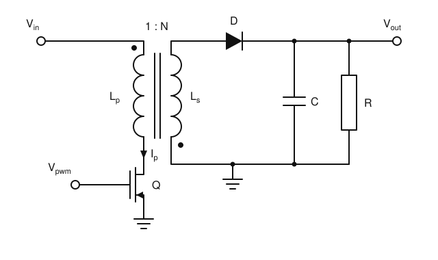
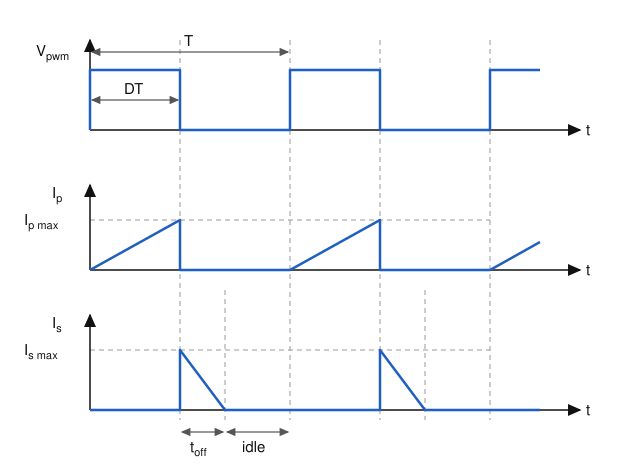

# Flyback Converter in DCM — Derivation of the Basic Formulas

This note derives the design equations for the flyback ("boost with a flyback
transformer") converter that generates the nixie-tube anode voltage. The
converter operates in **discontinuous conduction mode (DCM)**.

---

## 1. Circuit, notation and assumptions

The windings have opposite polarity (dots at opposite ends). While Q is on,
the diode is reverse-biased. While Q is off, the stored energy flows to the
output.

| Symbol | Meaning |
|---|---|
| $V_{in}$ | input voltage |
| $V_{out}$ | output voltage (nixie anode supply) |
| $N = N_s / N_p$ | turns ratio, secondary to primary |
| $L_p,\ L_s$ | primary and secondary (magnetizing) inductance |
| $T = 1/f$ | switching period; $f$ is the switching frequency |
| $D$ | duty cycle; Q is on for $DT$ |
| $t_{off}$ | time the diode conducts (demagnetization time) |
| $I_p,\ I_s$ | primary (switch) and secondary (diode) current |
| $I_{out}$ | average load current |
| $R$ | load resistance |
| $\eta$ | efficiency |

**Assumptions.** The switch and diode are ideal, with no voltage drop. The
transformer has no leakage and no winding resistance, and its core is linear
(unsaturated). $C$ is large enough that $V_{out}$ is constant within one
period. The converter is in steady state.

**Waveforms in DCM.** The PWM signal drives Q. The primary current $I_p$
ramps up from zero during $DT$ (§3). At turn-off it stops, and the secondary
current $I_s$ starts at $I_{s\,max}$ and ramps down to zero in $t_{off}$
(§4–§6). Both currents are then zero for the rest of the period (the idle
interval), which is what defines DCM (§7).

---

## 2. Flux of a winding

Faraday's law for $N$ turns linking the same core flux $\Phi$, and the
circuit law of an inductor:

$$
v = N\frac{d\Phi}{dt}, \qquad v = L\frac{dI}{dt}
$$

These describe the same voltage, so

$$
N\frac{d\Phi}{dt} = L\frac{dI}{dt}
\;\;\Rightarrow\;\;
\Phi = \frac{L I}{N} + C .
$$

In DCM each period starts from a fully demagnetized core ($I = 0$,
$\Phi = 0$), so the integration constant is $C = 0$:

$$
\boxed{\Phi = \frac{L I}{N}}
$$

$L I = N\Phi$ is the *flux linkage* (Wb·turns), which differs between
windings. $\Phi$ itself (Wb) is the quantity shared by both windings, and it
cannot change instantaneously because it holds the stored energy.

**Inductance ratio.** For a winding on a core of reluctance $\mathcal{R}$,
$\Phi = N I/\mathcal{R}$, so $L = N\Phi/I = N^2/\mathcal{R}$. Both windings
sit on the same core and therefore see the same $\mathcal{R}$:

$$
\frac{L_s}{L_p} = \frac{N_s^2}{N_p^2}
\;\;\Rightarrow\;\;
\boxed{L_s = L_p N^2}
$$

---

## 3. Interval 1: switch on, $0 < t < DT$

The full input voltage is across the primary, and the diode is
reverse-biased:

$$
L_p\frac{dI_p}{dt} = V_{in}
\;\;\Rightarrow\;\;
\frac{dI_p}{dt} = \frac{V_{in}}{L_p}.
$$

The current starts at zero (DCM) and rises linearly to

$$
\boxed{I_{p\,max} = \frac{V_{in}\, D T}{L_p}}
$$

---

## 4. Interval 2: switch off, diode conducts for $t_{off}$

The diode clamps the secondary to the output voltage, and the secondary
current falls linearly:

$$
-L_s\frac{dI_s}{dt} = V_{out}.
$$

It reaches zero after $t_{off}$, so

$$
\boxed{I_{s\,max} = \frac{V_{out}\, t_{off}}{L_s}}
$$

---

## 5. Flux continuity at turn-off

The core flux is the same just before and just after the switch opens:

$$
\Phi = \frac{L_p I_{p\,max}}{N_p} = \frac{L_s I_{s\,max}}{N_s}.
$$

The sheet normalizes the primary to $N_p = 1$, so $N_s = N$. This gives
$\dfrac{L_s I_{s\,max}}{N} = L_p I_{p\,max}$. Substituting $L_s = L_p N^2$:

$$
L_p N^2 \frac{I_{s\,max}}{N} = L_p I_{p\,max}
\;\;\Rightarrow\;\;
\boxed{I_{s\,max} = \frac{I_{p\,max}}{N}}
$$

This is the same as conservation of ampere-turns, $N_p I_{p\,max} = N_s
I_{s\,max}$. Energy is also conserved:
$\tfrac12 L_p I_{p\,max}^2 = \tfrac12 L_s I_{s\,max}^2$.

---

## 6. Demagnetization time

Combine §3, §4 and §5:

$$
\frac{V_{in} D T}{L_p N} = \frac{V_{out}\, t_{off}}{L_s} = \frac{V_{out}\, t_{off}}{L_p N^2}
\;\;\Rightarrow\;\;
\boxed{t_{off} = \frac{V_{in}}{V_{out}}\, N\, D T}
$$

**Cross-check (volt-second balance).** Refer everything to the primary. The
primary sees $+V_{in}$ for $DT$, then $-V_{out}/N$ for $t_{off}$. The
magnetizing current returns to zero, so
$V_{in} D T = \dfrac{V_{out}}{N} t_{off}$, which is the same result.

---

## 7. DCM condition and maximum duty cycle

DCM requires the core to be fully demagnetized before the next turn-on:

$$
t_{off} \le (1-D)T
\;\;\Rightarrow\;\;
\frac{V_{in}}{V_{out}} N D \le 1 - D
\;\;\Rightarrow\;\;
D\left(1 + \frac{N V_{in}}{V_{out}}\right) \le 1
$$

$$
\boxed{D \le D_{max} = \frac{V_{out}}{V_{out} + N V_{in}}}
$$

- $D < D_{max}$: DCM. There is an idle interval $(1-D)T - t_{off}$ in which
  both the switch and the diode are off.
- $D = D_{max}$: boundary (critical) conduction mode, with no idle time.
- $D > D_{max}$: CCM. The DCM formulas below no longer apply.

A smaller $N$ gives a larger $D_{max}$ and more available power. The price is
a higher switch voltage $V_{in} + V_{out}/N$ (§9.5).

---

## 8. Energy balance and maximum output current

**Energy drawn from the source per period.** Only the switch-on interval
draws input current, and it is a triangle with area $\tfrac12 I_{p\,max} D T$:

$$
E_{in} = V_{in}\cdot\frac{I_{p\,max}\, D T}{2} = \frac{V_{in}^2 D^2 T^2}{2L_p}.
$$

This equals the energy stored in the core, $\tfrac12 L_p I_{p\,max}^2$,
because $V_{in} D T = L_p I_{p\,max}$.

**Energy delivered to the load per period:** $E_{out} = V_{out} I_{out} T$.

**Balance.** With efficiency $\eta$, $E_{out} = \eta E_{in}$:

$$
\eta\,\frac{V_{in}^2 D^2 T^2}{2L_p} = V_{out} I_{out} T
\;\;\Rightarrow\;\;
\eta = \frac{2 V_{out} I_{out} L_p}{V_{in}^2 D^2 T}
$$

**Measuring the efficiency.** The expression above gives $\eta$ of a real
converter from quantities that are easy to measure. With the output regulated
at a known load, measure $V_{in}$, $V_{out}$, $I_{out}$ (or use
$I_{out} = V_{out}/R$) and the duty cycle $D$ at which the loop settles
(the actual on-time of the switch times $f$). $L_p$ and $f$ are known. A
lossless converter would need only

$$
D_{ideal} = \frac{1}{V_{in}}\sqrt{2 f L_p V_{out} I_{out}} ,
$$

and a real one settles at a larger $D$ to cover the losses, so

$$
\eta = \frac{2 f L_p V_{out} I_{out}}{V_{in}^2 D^2} = \left(\frac{D_{ideal}}{D}\right)^2 .
$$

This holds only in DCM, so check that $D \le D_{max}$. The result depends on
$D^2$ and on the real value of $L_p$, so errors in either carry over
directly. If the average input current is also measured,
$\eta = \dfrac{V_{out} I_{out}}{V_{in} I_{in,avg}}$ is a useful cross-check.

**Maximum output current in DCM** ($\eta = 1$, $D = D_{max}$):

$$
\boxed{I_{out\,max} = \frac{V_{in}^2 D_{max}^2\, T}{2 L_p V_{out}} = \frac{V_{in}^2 D_{max}^2}{2 f L_p V_{out}}}
$$

Substituting $D_{max}$ from §7 gives one expression:

$$
I_{out\,max} = \frac{V_{in}^2}{2 f L_p V_{out}}\left(\frac{V_{out}}{V_{out} + N V_{in}}\right)^2
$$

The maximum DCM output power is $P_{out\,max} = V_{out} I_{out\,max}$.

---

## 9. Additional results needed for the design

### 9.1 Output voltage vs. load: DCM needs feedback

Set $I_{out} = V_{out}/R$ in §8 (with $\eta = 1$):

$$
V_{out} = V_{in}\, D\,\sqrt{\frac{R\,T}{2L_p}}
$$

At a fixed duty cycle, $V_{out}$ rises with $\sqrt{R}$. With no load it rises
until something breaks. A nixie load changes constantly (digits switching,
multiplexing, blanking), so the converter **must run closed-loop**. Voltage
feedback from a divider on $V_{out}$, plus overvoltage protection, is
mandatory.

### 9.2 Duty cycle required for a given load

Solve §8 for $D$:

$$
D = \frac{1}{V_{in}}\sqrt{\frac{2 f L_p V_{out} I_{out}}{\eta}},
\qquad \text{valid while } D \le D_{max}.
$$

### 9.3 Input power and the supply limit

$$
P_{in} = E_{in} f = \frac{V_{in}^2 D^2}{2 f L_p} = \tfrac12 L_p I_{p\,max}^2 f,
\qquad
I_{in,avg} = \frac{I_{p\,max} D}{2}.
$$

In DCM the input power depends only on $D$ (equivalently on $I_{p\,max}$). It
does not depend on $V_{out}$ or the load. If the supply can deliver at most
$P_{in\,max}$, clamping the duty cycle or the peak current limits the input
power:

$$
D \le \frac{\sqrt{2 f L_p P_{in\,max}}}{V_{in}},
\qquad
I_{p\,max} \le \sqrt{\frac{2 P_{in\,max}}{L_p f}} .
$$

The output current is then limited to $I_{out} \le \eta P_{in\,max}/V_{out}$.

### 9.4 Choosing $L_p$

To deliver the required $P_{out}$ while staying in DCM with $D \le D_{max}$:

$$
L_p \le \frac{\eta\, V_{in}^2 D_{max}^2}{2 f P_{out}} .
$$

Choose $L_p$ close to this limit, with some margin: aim for
$D + t_{off}/T$ around 0.85–0.9 at full load. A larger $L_p$ lowers
$I_{p\,max}$ and the RMS currents, and so reduces conduction losses.

### 9.5 Voltage stress on the semiconductors

| Device | Ideal stress | Notes |
|---|---|---|
| MOSFET, $V_{DS}$ | $V_{in} + \dfrac{V_{out}}{N}$ | The leakage-inductance spike adds to this, so a clamp/snubber is needed |
| Diode, reverse voltage $V_R$ | $V_{out} + N V_{in}$ | Use a fast or ultrafast diode |

The term $V_{out}/N$ is the *reflected voltage* $V_{OR}$. Choose $N$ so that
$V_{in} + V_{OR}$ plus the spike stays below the MOSFET rating with margin.

### 9.6 Output voltage ripple

During $t_{off}$ the diode current is
$I_s(t) = I_{s\,max}(1 - t/t_{off})$. The capacitor charges while
$I_s > I_{out}$ and supplies the load for the rest of the period. The charge
gained is the triangle above $I_{out}$:

$$
\Delta Q = \frac{t_{off}\,(I_{s\,max} - I_{out})^2}{2\, I_{s\,max}}
\;\;\Rightarrow\;\;
\Delta V_{out} \approx \frac{t_{off}\,(I_{s\,max} - I_{out})^2}{2\, C\, I_{s\,max}} + I_{s\,max}\, R_{ESR}.
$$

A simple conservative bound is $\Delta V_{out} \le \dfrac{I_{out} T}{C} + I_{s\,max} R_{ESR}$.
