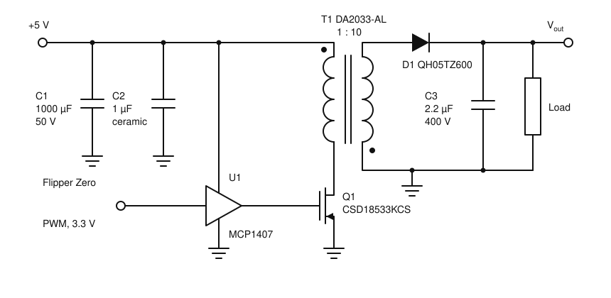
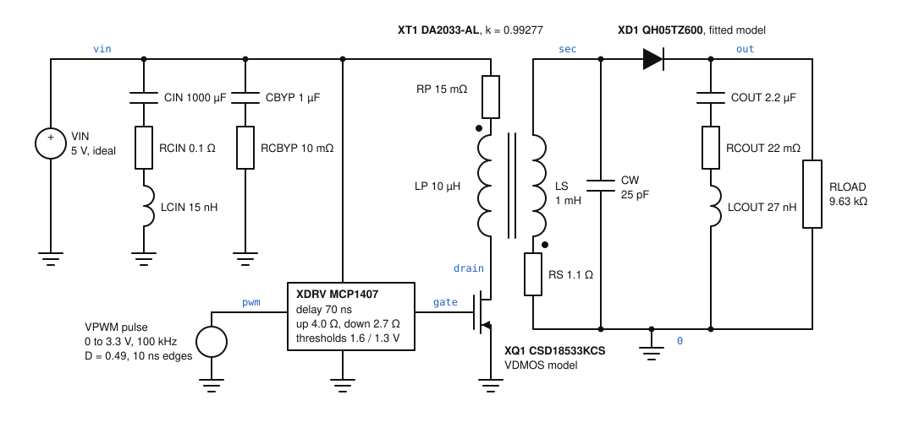
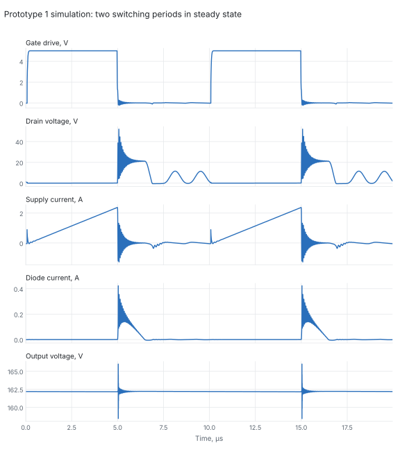

# Prototype 1

First bench prototype of the flyback converter. It runs open-loop: a Flipper
Zero generates the PWM signal and the duty cycle is set by hand.

## Components

| Function | Part | Notes |
|---|---|---|
| Flyback transformer | Coilcraft DA2033-AL | $L_p$ = 10 µH, turns ratio 1 : 10 |
| Output diode | Power Integrations QH05TZ600 | Qspeed H-series, 600 V, 5 A, TO-220AC |
| Switch | Texas Instruments CSD18533KCS | N-channel MOSFET, 60 V, TO-220 |
| Gate driver | Microchip MCP1407 | Non-inverting low-side driver |
| Output capacitor | WIMA MKS4, 2.2 µF, 400 V | Metallized polyester film |
| Input capacitor | Nichicon, 1000 µF, 50 V | Aluminium electrolytic |
| Bypass capacitor | 1 µF ceramic | |
| PWM source | Flipper Zero | 3.3 V logic output, drives the MCP1407 input |

Datasheets: see [`docs/datasheets`](../docs/datasheets/README.md).

## Schematic



The driver U1 is powered from the same 5 V rail, with C2 at its supply pin.
There is no snubber, clamp or feedback.

## Ideal characteristics

Calculated with the lossless DCM formulas from
[`docs/theory.md`](../docs/theory.md) ($\eta = 1$). Parasitics and datasheet
limits are not included yet.

### Operating conditions

| Quantity | Value |
|---|---|
| Input voltage $V_{in}$ | 5 V |
| Output voltage $V_{out}$ | 170 V |
| Switching frequency $f$ | 100 kHz ($T$ = 10 µs) |
| Primary inductance $L_p$ | 10 µH |
| Turns ratio $N$ | 10 |
| Output capacitor $C$ | 2.2 µF |
| Input power limit of the 5 V supply | 3 W |

### Fixed values

| Quantity | Formula | Value |
|---|---|---|
| Secondary inductance | $L_s = N^2 L_p$ | 1 mH |
| Maximum DCM duty cycle | $D_{max} = \dfrac{V_{out}}{V_{out} + N V_{in}}$ | 0.773 |
| Maximum DCM output current | $\dfrac{V_{in}^2 D_{max}^2}{2 f L_p V_{out}}$ | 43.9 mA (7.46 W) |
| MOSFET voltage | $V_{in} + V_{out}/N$ | 22 V |
| Diode reverse voltage | $V_{out} + N V_{in}$ | 220 V |
| Input power vs. duty cycle | $P_{in} = \dfrac{V_{in}^2 D^2}{2 f L_p}$ | $12.5\,D^2$ W |

The 3 W supply limits the converter well before the DCM boundary:

| Quantity | Formula | Value |
|---|---|---|
| Duty cycle at 3 W | $D = \sqrt{2 f L_p P_{in}}/V_{in}$ | 0.49 |
| Output current at 3 W | $P_{in}/V_{out}$ | 17.6 mA |

### Operating points at $V_{out}$ = 170 V

Each row is the duty cycle that holds 170 V at the given load.

| $D$ | $t_{on}$, µs | $I_{p\,max}$, A | $I_{s\,max}$, mA | $t_{off}$, µs | Idle, µs | $I_{in,avg}$, A | $P_{in}$, W | $I_{out}$, mA | Load $R$, kΩ | Ripple $\Delta V_{out}$, mV |
|---|---|---|---|---|---|---|---|---|---|---|
| 0.10 | 1.00 | 0.50 | 50 | 0.29 | 8.71 | 0.025 | 0.125 | 0.74 | 231 | 3 |
| 0.20 | 2.00 | 1.00 | 100 | 0.59 | 7.41 | 0.10 | 0.50 | 2.94 | 57.8 | 13 |
| 0.30 | 3.00 | 1.50 | 150 | 0.88 | 6.12 | 0.225 | 1.125 | 6.62 | 25.7 | 27 |
| 0.40 | 4.00 | 2.00 | 200 | 1.18 | 4.82 | 0.40 | 2.00 | 11.8 | 14.5 | 47 |
| **0.49** | **4.90** | **2.45** | **245** | **1.44** | **3.66** | **0.60** | **3.00** | **17.6** | **9.63** | **69** |
| 0.50 | 5.00 | 2.50 | 250 | 1.47 | 3.53 | 0.625 | 3.125 | 18.4 | 9.25 | 72 |
| 0.60 | 6.00 | 3.00 | 300 | 1.76 | 2.24 | 0.90 | 4.50 | 26.5 | 6.42 | 100 |
| 0.70 | 7.00 | 3.50 | 350 | 2.06 | 0.94 | 1.225 | 6.125 | 36.0 | 4.72 | 132 |
| 0.773 | 7.73 | 3.86 | 386 | 2.27 | 0 | 1.49 | 7.46 | 43.9 | 3.87 | 157 |

The bold row is the 3 W supply limit. Rows below it need more input power
than the supply can deliver. The last row is the DCM/CCM boundary.

### Open-loop warning

There is no feedback, so the output voltage follows the load:

$$
V_{out} = V_{in}\, D\,\sqrt{\frac{R\,T}{2L_p}} = 3.54\; D\,\sqrt{R}\ \text{V} \quad (R \text{ in } \Omega).
$$

For a given load, use the table to find the duty cycle for 170 V and do not
exceed it. With a light or missing load the output rises far above 170 V and
past the 400 V rating of the output capacitor. Always connect the load before
enabling the PWM, and start from a low duty cycle.

## Simulation

The folder [`simulation_vendor`](simulation_vendor) holds an ngspice model of the schematic
above. It contains only the parts of the prototype, each with its own
parasitics taken from the datasheets in `docs/datasheets`.

| File | Contents |
|---|---|
| `simulation_vendor/prototype1.cir` | Main netlist: circuit, analysis and measurements |
| `simulation_vendor/models/da2033al.lib` | Transformer |
| `simulation_vendor/models/csd18533kcs_datasheet.lib` | MOSFET |
| `simulation_vendor/models/qh05tz600_datasheet.lib` | Output diode |
| `simulation_vendor/models/mcp1407_behavioral.lib` | Gate driver |
| `simulation_vendor/plot_waveforms.py` | Plots the saved waveforms (needs numpy and matplotlib) |
| `simulation_vendor/simulated_circuit.svg` | The circuit as simulated |

### Simulated circuit



This is the netlist drawn out: the prototype schematic with the parasitic
elements of each part added. Element names match `prototype1.cir` and the
model files, and the blue labels are the node names. The driver, MOSFET and
diode are subcircuits; their contents are described below.

### Running it

```
cd prototype1/simulation_vendor
ngspice -b prototype1.cir
python3 plot_waveforms.py
```

Tested with ngspice 42; one run takes about a minute. The parameters at the
top of the netlist set the operating point: `VIN`, `FSW`, `DUTY`, `RLOAD`.
The default is the 3 W point of the ideal table: `DUTY` = 0.49 and `RLOAD` =
9.63 kΩ.

The run starts with the output capacitor discharged and simulates 120 ms,
about five time constants of $R\,C$ = 21 ms, so the last periods are in steady
state. Measurements are printed at the end and the last two periods are
written to `waveforms.txt`.

### Vendor models

None of the models in the repository comes from a vendor. All four are built
from datasheet values as described below.

| Part | Vendor model | Used here |
|---|---|---|
| CSD18533KCS | TI publishes an unencrypted PSpice model, `SLPM047A.ZIP`, on the [product page](https://www.ti.com/product/CSD18533KCS) under "Design & development" | Datasheet-based VDMOS model |
| QH05TZ600 | None found | Datasheet-based model |
| MCP1407 | None found; check the [product page](https://microchip.com/en-us/product/mcp1407) | Behavioural model |
| DA2033-AL | None found | Coupled inductors |
| MKS4, electrolytic, ceramic | None found | Series R-L-C |

The TI model could not be downloaded from the environment this was written
in. To use it, download the ZIP, put the `.lib` file in `simulation_vendor/models/`
as `CSD18533KCS.lib`, and swap the two `.include` lines in the netlist. The
pin order must be drain, gate, source. This has not been tested.

### How the model parameters were chosen

All values are typical values at 25 °C unless noted.

**Transformer DA2033-AL** (`da2032.pdf`)

| Parameter | Value | Source |
|---|---|---|
| Primary inductance | 10 µH | Table, inductance at 0 A |
| Secondary inductance | 1 mH | $L_s = N^2 L_p$, with $N$ = 10 |
| Coupling coefficient | 0.99277 | From the leakage inductance, 0.144 µH max, measured at the primary with the secondary shorted: $L_{lk} = L_p(1-k^2)$, so $k = \sqrt{1 - L_{lk}/L_p}$ |
| Primary resistance | 15 mΩ | DCR max, primaries in parallel |
| Secondary resistance | 1.1 Ω | DCR max |
| Winding capacitance | 25 pF across the secondary | Estimate: one third of the 76 pF interwinding capacitance |

The datasheet gives the capacitance between the windings with each winding
shorted. In the circuit the voltage along the secondary rises linearly from
zero at the grounded end, so only part of that capacitance is charged to the
full swing. For a linear distribution the equivalent value at the hot end is
one third. This is an estimate; it sets the frequency of the ringing after
the core has demagnetized.

Core saturation is not modelled. The datasheet guarantees at least 9 µH at
5 A, so the model is valid up to 5 A of primary current.

**MOSFET CSD18533KCS** (`csd18533kcs.pdf`), ngspice `VDMOS` model

| Parameter | Value | Source |
|---|---|---|
| `vto` | 1.9 V | $V_{GS(th)}$ typ |
| `kp` | 150 A/V² | From $g_{fs}$ = 150 S at 75 A: $K_p = g_{fs}^2/(2 I_D)$ |
| `rd` + `rs` | 4.3 mΩ | $R_{DS(on)}$ = 6.9 mΩ at 4.5 V minus the channel resistance $1/(K_p (V_{GS}-V_{th}))$ = 2.6 mΩ |
| `rg` | 1.4 Ω | Series gate resistance typ |
| `cgs` | 2413 pF | $C_{iss} - C_{rss}$ |
| `cgdmin`, `cgdmax`, `a` | 7 pF, 2 nF, 0.9 | `cgdmin` is $C_{rss}$ at 30 V; the other two were adjusted until the gate-drain charge over 0–30 V equals $Q_{gd}$ = 3.9 nC |
| `cjo`, `vj`, `m` | 3.9 nF, 1.5 V, 0.85 | Fitted to $C_{oss} - C_{rss}$ = 293 pF at 30 V and to $Q_{oss}$ |
| `is`, `n`, `rb` | 0.9 nA, 1, 2 mΩ | Body diode: $V_{SD}$ = 0.8 V at 75 A |
| `bv` | 60 V | $BV_{DSS}$ minimum |

Checks of the finished model against the datasheet:

| Quantity | Model | Datasheet (typ) |
|---|---|---|
| $R_{DS(on)}$ at 4.5 V, 75 A | 7.1 mΩ | 6.9 mΩ |
| $R_{DS(on)}$ at 10 V, 75 A | 5.1 mΩ | 5.0 mΩ |
| Body diode drop at 75 A | 0.80 V | 0.8 V |
| Breakdown voltage | 60.2 V | 60 V min |
| $Q_{gd}$ | 3.9 nC | 3.9 nC |
| $Q_{oss}$ at 30 V | 26.5 nC | 31 nC |
| $C_{oss}$ near 30 V | 360 pF | 300 pF |

The simple junction-capacitance law cannot match both $C_{oss}$ and
$Q_{oss}$, so the fit sits between them. Package inductance is not modelled.

**Diode QH05TZ600** (`qh05tz600.pdf`)

| Parameter | Value | Source |
|---|---|---|
| Forward curve | $I = 2.26\,\text{mA}\,(e^{V/0.3128\,\text{V}} - 1)$ in series with 37.8 mΩ | Fitted to Figure 3 at 25 °C through 2 A / 2.2 V, 5 A / 2.6 V and 20 A / 3.6 V |
| `cjo`, `vj`, `m` | 41 pF, 1 V, 0.37 | Fitted to 17 pF at 10 V (table) and 6 pF at 180 V (Figure 4) |
| `tt` | 1.3 ns | $Q_{RR}/I_F$ = 6.5 nC / 5 A |
| `bv` | 600 V | $V_{RRM}$ |

The fitted curve gives 1.48 V at 0.25 A, 3.0 V at 10 A and a reverse leakage
below 1 nA at 220 V. The forward curve is a behavioural current source
because a plain SPICE diode with this soft slope would leak milliamps in
reverse; the model file explains the structure.

**Gate driver MCP1407** (`MCP1407.pdf`), read at $V_{DD}$ = 5 V

| Parameter | Value | Source |
|---|---|---|
| Input thresholds | 1.6 V rising, 1.3 V falling | Figure 2-11 |
| Propagation delay | 70 ns | Figure 2-6 at 5 V (the 40 ns in the table is for 18 V) |
| Pull-up resistance | 4.0 Ω | Figure 2-19 at 5 V (2.1 Ω at 18 V) |
| Pull-down resistance | 2.7 Ω | Figure 2-20 at 5 V (1.5 Ω at 18 V) |
| Input capacitance | 25 pF | Functional block diagram |
| Supply current | 130 µA | Table, logic-high input |

The output stage is two switches, so the gate edges are set by these
resistances and the MOSFET gate charge. The 3.3 V Flipper signal is above the
2.4 V guaranteed logic-high level.

**Capacitors**

| Part | Model | Source |
|---|---|---|
| C3, MKS4 2.2 µF 400 V | 2.2 µF + 22 mΩ + 27 nH | ESR = $\tan\delta/(2\pi f C)$ with $\tan\delta$ = 0.03 at 100 kHz. The datasheet gives 0.03 at 100 kHz only for values up to 0.1 µF, so this is an extrapolation. The inductance assumes about 1 nH per mm of the 27.5 mm pin spacing, a rule of thumb that is not in the datasheet |
| C1, Nichicon 1000 µF 50 V | 1000 µF + 0.1 Ω + 15 nH | Assumed. The series is not known and there is no datasheet |
| C2, 1 µF ceramic | 1 µF + 10 mΩ | Assumed, no datasheet |

**Sources and load**

- The 5 V supply is an ideal voltage source with no current or power limit.
- The Flipper Zero output is an ideal 0–3.3 V pulse with 10 ns edges (assumed).
- The load is a resistor.
- There is no wiring resistance or inductance. With an ideal supply connected
  directly across them, C1 and C2 carry almost no current in the simulation.

### Results

At `DUTY` = 0.49 and `RLOAD` = 9.63 kΩ, steady state:

| Quantity | Simulation | Ideal theory |
|---|---|---|
| Output voltage | 162.2 V | 170 V |
| Output current | 16.8 mA | 17.6 mA |
| Input power | 2.82 W | 3.00 W |
| Output power | 2.73 W | 3.00 W |
| Efficiency $P_{out}/P_{in}$ | 96.9 % | 100 % |
| Average supply current | 0.56 A | 0.60 A |
| Peak primary current | 2.38 A | 2.45 A |
| Peak drain voltage | 52 V | 22 V |
| Peak diode reverse voltage | 223 V | 220 V |
| Ripple on the capacitance of C3 | 67 mV | 69 mV |
| Ripple at the output terminals | 9.3 V peak to peak | – |



What the simulation shows beyond the ideal theory:

- **Drain voltage spike.** At turn-off the leakage inductance rings with the
  MOSFET output capacitance and the drain reaches 52 V, against a 60 V
  rating. Nothing limits this spike except the MOSFET itself.
- **Start-up.** With the output capacitor empty the core cannot demagnetize,
  and the primary current climbs from cycle to cycle to 18.8 A, about 135 µs
  after the PWM starts. The drain then reaches 60.5 V, which is the MOSFET
  avalanching. In the real circuit the transformer saturates above 5 A and
  the 5 V supply cannot deliver this current, so start-up will look
  different. Ramping the duty cycle up slowly avoids the problem.
- **Output spikes.** The 9.3 V figure is the narrow spikes produced by the
  diode current step in the assumed 27 nH of C3. It depends directly on that
  estimate.
- **Ringing after demagnetization.** Once the diode stops conducting, the
  primary inductance rings with the MOSFET and winding capacitance at about
  700 kHz until the next turn-on.
- **Lower output than ideal.** The output is 162 V instead of 170 V. Part of
  this is real loss (3 %), and part is that less energy is taken in: the peak
  current is 2.38 A instead of 2.45 A. The efficiency formula in
  `docs/theory.md`, which uses the measured duty cycle, counts both effects
  and gives 91 % for this point.

### Limitations

- Typical 25 °C values; no tolerances or temperature effects.
- No core saturation, core loss or skin effect in the transformer.
- No wiring, PCB or package inductance, so real ringing and spikes will differ.
- Ideal supply: the 3 W limit of the real supply is not modelled.
- The MOSFET, diode and driver models are fits to datasheet values, not
  vendor models.
