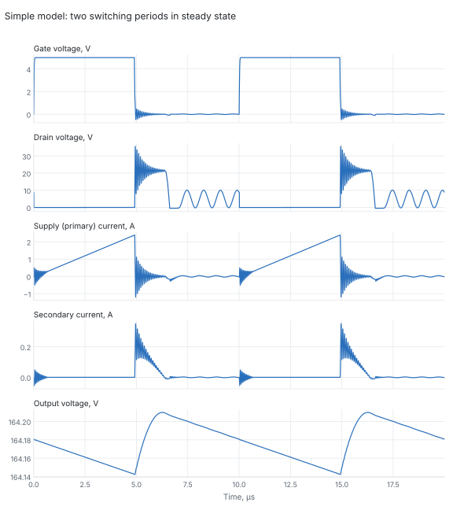

# Prototype 1 – simple simulation

The simplest ngspice model of the [prototype 1](../README.md) converter that
still shows how the real parts differ from the ideal theory. It is one flat
netlist of 17 elements: no vendor models, no subcircuits, no behavioural
sources. Every value is a number from a datasheet in
[`docs/datasheets`](../../docs/datasheets/README.md) or follows from one by
the formula given below.

The more detailed model is in [`../simulation`](../simulation).

| File | Contents |
|---|---|
| `flyback_simple.cir` | Netlist, analysis and measurements |
| `plot_waveforms.py` | Plots the saved waveforms (needs numpy and matplotlib) |
| `waveforms.svg` | Result of the plot script |

## Running it

```
cd prototype1/simulation_simple
ngspice -b flyback_simple.cir
python3 plot_waveforms.py
```

Tested with ngspice 42; one run takes about a minute. The parameters at the
top of the netlist set the operating point: `VIN`, `FSW`, `DUTY`, `RLOAD`.
The default is the 3 W point of the ideal table: `DUTY` = 0.49 and
`RLOAD` = 9.63 kΩ.

The output capacitor starts charged to `VSTART` = 170 V, the ideal value for
this operating point, so there is no start-up transient. The run lasts 100 ms,
about five time constants of $R\,C$ = 21 ms, and the output settles to its
real value. For another operating point set `VSTART` to the expected output
voltage and keep the run at least five time constants long. The last two
periods are written to `waveforms.txt`.

## Circuit

```
           RP      LP                  LS      RS        D1
 vin ──┬──[15m]──[10u]──┬── drain   ┌─[1m]──[1.1]── sec ─▶|──┬────────┬── out
       │           ·    │           │   ·                    │        │
      VIN        KT = 0.99277      gnd                     COUT     RLOAD
      5 V               │                                  2.2u     9.63k
       │     ┌──────────┼─────────┬──────────┐               │        │
      gnd    │          │         │          │              gnd      gnd
            CGD        SQ1       CDS        DQ1
            130p     6.9 mΩ      903p     body diode
             │          │         │          │
 drv ─[RDRV]─[RG]─ gate ┴ gnd    gnd        gnd
      3.4    1.4    │
                   CGS 2413p
                    │
                   gnd
```

`VDRV` drives node `drv` with a 0–5 V pulse. The switch `SQ1` closes when the
gate voltage is above the threshold. The dots mark the winding polarity: the
secondary conducts when the switch opens.

## Where each value comes from

All datasheet values are typical values at 25 °C.

### MOSFET CSD18533KCS

The MOSFET is a switch with three constant capacitors and a body diode.

| Element | Value | Datasheet values used | Formula |
|---|---|---|---|
| `SQ1` on-resistance | 6.9 mΩ | $R_{DS(on)}$ at $V_{GS}$ = 4.5 V | – |
| `SQ1` threshold | 1.9 V | $V_{GS(th)}$ | – |
| `RG` | 1.4 Ω | Series gate resistance $R_G$ | – |
| `CGS` | 2413 pF | $C_{iss}$ = 2420 pF, $C_{rss}$ = 7 pF | $C_{iss} - C_{rss}$ |
| `CGD` | 130 pF | $Q_{gd}$ = 3.9 nC at $V_{DS}$ = 30 V | $Q_{gd} / V_{DS}$ |
| `CDS` | 903 pF | $Q_{oss}$ = 31 nC at $V_{DS}$ = 30 V | $Q_{oss} / V_{DS} - C_{GD}$ |
| `DQ1` | 0.8 V at 75 A | Body diode $V_{SD}$ | Plain diode, `is` = 1 nA, `rs` = 2 mΩ |

The real capacitances depend strongly on the drain voltage: $C_{oss}$ is
about 2.5 nF at 0 V and 300 pF at 30 V. A constant capacitor cannot follow
that curve, so `CGD` and `CDS` are charge-equivalent values: they hold the
datasheet charge at 30 V. The drain in this circuit swings to about 22 V, so
the stored charge is close to the real one, but the shape of the edges is not.

As a check, the model needs $C_{GS}\cdot 4.5\,\text{V} + Q_{gd}$ = 14.8 nC to
bring the gate to 4.5 V. The datasheet gives 14 nC.

The switch has no transconductance: it is fully on or fully off. It switches
at the threshold voltage with 0.1 V of hysteresis each way, which is not a
datasheet value.

### Output diode QH05TZ600

A standard SPICE diode model.

| Parameter | Value | Datasheet values used |
|---|---|---|
| `is`, `n`, `rs` | 8.4 pA, 2, 0.24 Ω | $V_F$ = 2.6 V at 5 A (table); knee near 1.2 V (Figure 3) |
| `cjo`, `vj`, `m` | 41 pF, 1 V, 0.37 | $C_J$ = 17 pF at 10 V (table); about 6 pF at 180 V (Figure 4) |
| `tt` | 1.3 ns | $Q_{RR}$ = 6.5 nC at $I_F$ = 5 A: $t_t = Q_{RR}/I_F$ |
| `bv`, `ibv` | 600 V, 250 µA | $V_{RRM}$ and maximum reverse current |

The forward curve gives 1.22 V at 0.1 A, 1.31 V at 0.25 A and 2.60 V at 5 A.
The converter works below 0.4 A, where Figure 3 cannot be read accurately, so
the forward drop in this range is an estimate. It is fixed by the table point
at 5 A and the knee voltage only; the curve between 1 A and 20 A is not
fitted.

### Transformer DA2033-AL

Two coupled inductors with their winding resistances.

| Element | Value | Source |
|---|---|---|
| `LP` | 10 µH | Primary inductance |
| `LS` | 1 mH | $L_s = N^2 L_p$, $N$ = 10 |
| `KT` | 0.99277 | Leakage inductance 0.144 µH max: $k = \sqrt{1 - L_{lk}/L_p}$ |
| `RP` | 15 mΩ | Primary DCR max |
| `RS` | 1.1 Ω | Secondary DCR max |

### Everything else

| Element | Value | Source |
|---|---|---|
| `VIN` | 5 V | Ideal source |
| `VDRV` | 0–5 V pulse, 10 ns edges | Ideal gate driver; the edge time is assumed |
| `RDRV` | 3.4 Ω | MCP1407 output resistance at 5 V: mean of 4.0 Ω pull-up and 2.7 Ω pull-down (Figures 2-19, 2-20) |
| `COUT` | 2.2 µF | Ideal capacitor |
| `RLOAD` | 9.63 kΩ | Load |

## What is left out

Compared with the detailed model in [`../simulation`](../simulation):

- Gate driver delay, input thresholds and separate pull-up and pull-down
  resistances.
- Voltage dependence of the MOSFET capacitances, and its transconductance.
- MOSFET breakdown: the switch does not avalanche at 60 V.
- Transformer winding capacitance, core loss and saturation.
- Series resistance and inductance of the output capacitor.
- Input and bypass capacitors. With an ideal supply they carry no current.
- Start-up from a discharged output.

## Results

At `DUTY` = 0.49 and `RLOAD` = 9.63 kΩ, steady state:

| Quantity | Simple model | Detailed model | Ideal theory |
|---|---|---|---|
| Output voltage | 164.2 V | 162.2 V | 170 V |
| Output current | 17.0 mA | 16.8 mA | 17.6 mA |
| Input power | 2.86 W | 2.82 W | 3.00 W |
| Output power | 2.80 W | 2.73 W | 3.00 W |
| Efficiency $P_{out}/P_{in}$ | 97.8 % | 96.9 % | 100 % |
| Average supply current | 0.57 A | 0.56 A | 0.60 A |
| Peak primary current | 2.39 A | 2.38 A | 2.45 A |
| Peak secondary current | 0.35 A | 0.45 A | 0.245 A |
| Peak drain voltage | 35.6 V | 52 V | 22 V |
| Peak diode reverse voltage | 300 V | 223 V | 220 V |
| Output ripple | 68 mV | 67 mV on the capacitance | 69 mV |
| Gate drive power | 5.5 mW | – | – |

The detailed-model column is copied from [`../README.md`](../README.md). The
gate drive power is taken from the `VDRV` source and is not part of the input
power.



What the simple model shows:

- **Power and output voltage** agree with the detailed model within 2 %. The
  peak primary current is 2.39 A instead of the ideal 2.45 A, because the gate
  takes time to charge and the switch and winding resistances reduce the
  voltage across the primary. Less energy is stored per cycle, so the output
  is 164 V instead of 170 V.
- **Drain spike at turn-off.** The leakage inductance rings with the MOSFET
  capacitance at about 13 MHz and the drain reaches 36 V. The detailed model
  gives 52 V. The difference comes from the constant 1 nF used here in place
  of the real output capacitance, which falls to 300 pF as the drain voltage
  rises.
- **Ringing after demagnetization.** Once the diode stops conducting, the
  primary inductance rings with the MOSFET and diode capacitance at about
  1.1 MHz until the next turn-on. The drain touches zero and the body diode
  clips it.
- **Ringing at turn-on.** The leakage inductance rings with the diode
  capacitance. The secondary swings about 120 V peak to peak, which is why
  the peak diode reverse voltage is 300 V instead of 220 V.

## Limits of the results

- Nothing in the model damps the ringing except the winding and switch
  resistances, so every ring lasts longer and swings further than it will on
  the bench. The 300 V diode reverse voltage and the 0.35 A secondary peak are
  ringing peaks and should be read as upper bounds of this model, not as
  predictions.
- The energy taken in each cycle depends on where in the 1.1 MHz ring the
  switch turns on. A small change of frequency, duty cycle or capacitance
  moves that point and can shift the output by several volts.
- The drain spike depends on the constant-capacitance approximation and on the
  maximum leakage inductance from the datasheet. No wiring or package
  inductance is included.
- The model has not been compared with measurements.
